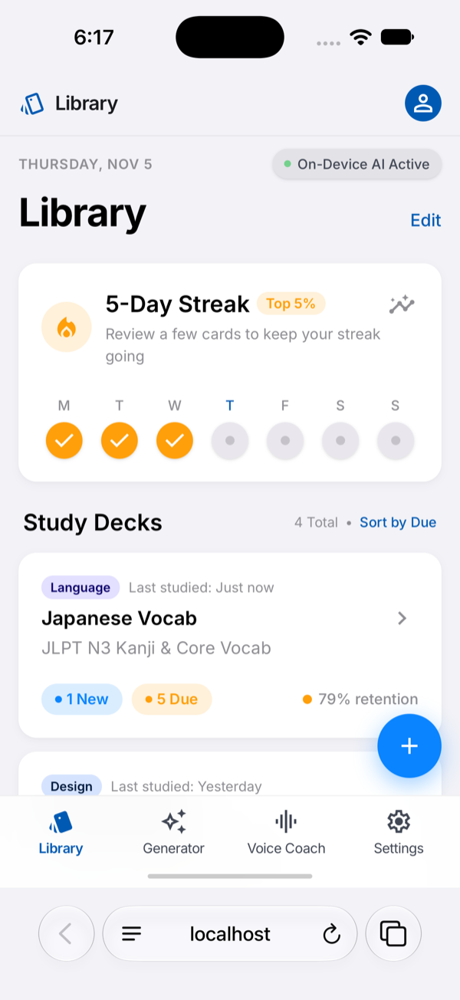
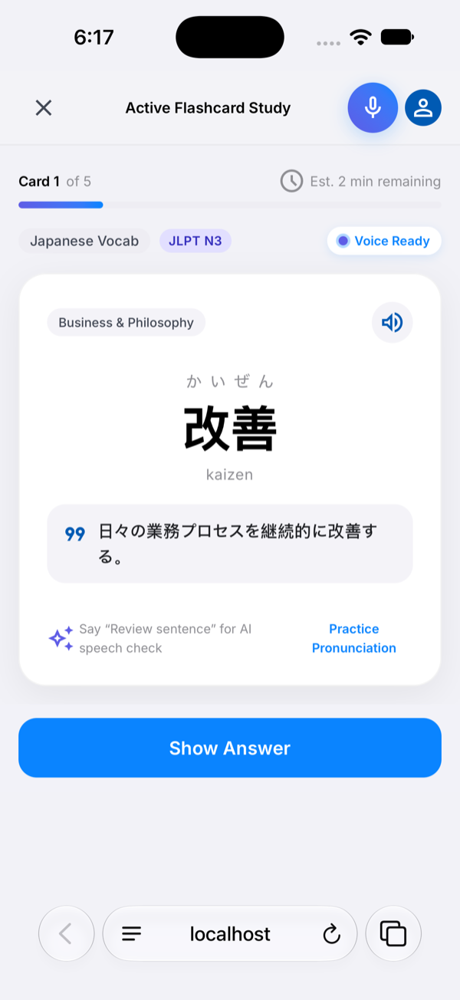
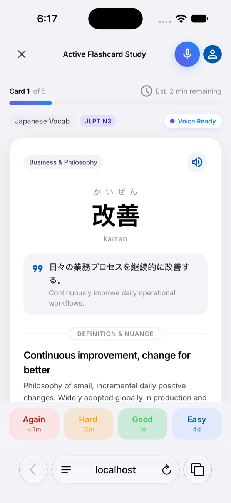

# Aura

**An AI study tutor with spaced-repetition flashcards built in.**

<p>
  
  
  
</p>

---

## Why I built it

I was learning Japanese alongside work topics like product design and system architecture, and I kept switching between two kinds of tools.

**Flashcard apps** were great at making me remember. Spaced repetition works, and apps like Anki prove it. But they only drill: when a word or concept didn't click, the app had nothing to say. It just showed the card again.

**AI chats** were great at explaining. I could ask what a word really means, when to use it, or why an architecture works the way it does. But nothing stuck. The next week the chat had no idea what I'd learned, what I kept getting wrong, or what I should review.

Nothing I used did both: **explain like a tutor, and remember like a flashcard system.** That's the gap Aura is built for. The flashcards are the memory, and the AI is the teacher that works on top of them.

---

## What it does today

| | |
|---|---|
| **Spaced-repetition study** | Decks with four-button grading (Again, Hard, Good, Easy) that schedules each card. Due counts are calculated from the cards themselves, so every screen agrees. |
| **Recall first** | Each card shows only the prompt until you tap **Show Answer**. Grades stay pinned within thumb reach, and you can swipe left or right to grade. |
| **AI card generation** | Paste notes and the AI drafts cards with meaning, nuance, a mnemonic and an example sentence (plus readings and romaji for Japanese). You keep or discard each one before it reaches a deck. |
| **Voice recall** | Say the answer aloud. The AI scores how well you recalled the meaning, and the card is graded from that score. |
| **Any AI provider** | Gemini by default, or any OpenAI-compatible model (OpenAI, OpenRouter, a local Ollama) by editing `.env`. |
| **Your data stays local** | Decks, cards and progress are saved in the browser. Only the text you send for generation or scoring goes to the AI provider. |

**Not real yet:** the Settings screen's on-device model manager (Llama, Phi-3.5, voice downloads) is a design mockup. Nothing downloads or runs locally.

---

## Product thinking

Aura started as a fast prototype. I then audited it like a real product: I tested every screen on an iPhone simulator, found the problems, and fixed them before adding features.

**[Read the UX case study (PDF, 19 slides)](docs/ux-case-study/Aura-UX-Case-Study.pdf)**

It covers:
- **Audit:** the due counts disagreed between screens, the answer was visible before recall, and the grade buttons sat below the fold
- **Three proto-personas:** an exam crammer, a busy professional and a lapsed learner, each with a journey map
- **User stories** with acceptance criteria, design principles and an impact-versus-effort prioritization
- **What shipped:** the before-and-after study screen ([PR #1](https://github.com/MadhavSomanath/Aura/pull/1))
- **The proposed v2:** a single "Today" screen, three tabs instead of four, and a catch-up mode for returning learners
- **How success would be measured:** weekly active review days, with an input metric for each persona

---

## Roadmap

Aura's next step is to become the tutor.

- [x] Spaced-repetition engine, decks, and recall-first study flow
- [x] AI card generation and voice recall scoring
- [x] Runs anywhere with any AI provider, not tied to the tool it was prototyped in ([PR #3](https://github.com/MadhavSomanath/Aura/pull/3))
- [ ] **Tutor chat:** a chat that can read your decks and act on them: tell you what to study, explain a card you keep missing, create cards as you talk, and quiz you in the conversation
- [ ] **Tutor memory:** live due counts and weak cards sent with every message, plus a learner profile (exam date, recurring mistakes) that you can view and edit
- [ ] **Today screen and catch-up mode** from the case study
- [ ] **Use it anywhere:** hosted behind a passcode and installable on a phone home screen, with progress synced across devices

---

## Run it yourself

You need Node.js 20 or later, and an API key for an AI provider.

```bash
git clone https://github.com/MadhavSomanath/Aura.git
cd Aura
npm install
cp .env.example .env    # then add your AI_API_KEY
npm run dev
```

Open http://localhost:3000. Without a key the app still runs; the AI features say they aren't set up.

To use a provider other than Gemini, set `AI_BASE_URL` and `AI_MODEL` in `.env`. The examples are in [`.env.example`](.env.example).

The server only accepts connections from your own computer, and each client can make 20 AI requests a minute. To try it on a phone on the same Wi-Fi, set `HOST=0.0.0.0` in `.env`. Anyone on that network can then use your AI key, so only do this on a network you trust.

```bash
npm run lint     # type-check
npm run build    # production build
```

---

## How it's built

```
Aura/
├── src/                  React app (Vite, Tailwind)
│   ├── views/            Library, deck detail, study, generator, voice coach, settings
│   ├── components/       Shared UI: nav, header, modals
│   ├── context/          DeckContext: decks, cards, scheduling, saved to localStorage
│   └── services/         Browser speech recognition and text-to-speech
├── server/
│   ├── index.ts          Express server: serves the app and the /api routes
│   └── ai.ts             One call to any OpenAI-compatible model
└── docs/
    ├── ux-case-study/    The case study deck (PDF)
    └── images/           Screenshots
```

- **Frontend:** React 19, TypeScript, Vite and Tailwind. All study state lives in one React context and is saved to `localStorage`.
- **Backend:** a small Express server. It keeps the API key on the server and exposes `/api/generate-cards`, `/api/voice-feedback` and `/api/ai-status`. AI replies are checked before they reach your decks.
- **Speech:** the browser's built-in speech recognition and voices.

---

## License

Apache-2.0
